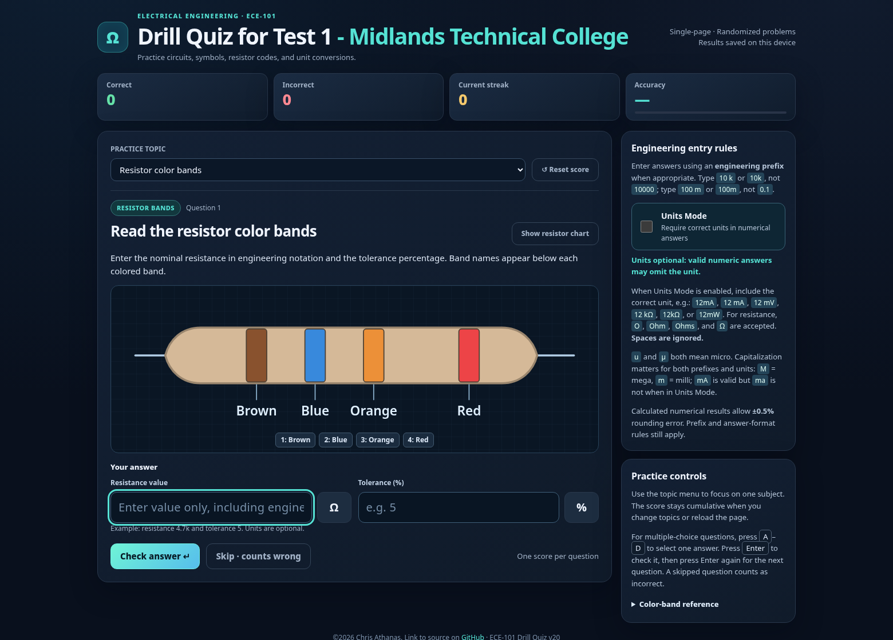

# ECE-101 Drill Quiz for Test 1 — Midlands Technical College



**[Launch the live quiz](https://realityexpander.github.io/ECE-101-Electronics-Quiz-App-for-Test-1-Resistors-Ohms-Law-KCL-KVL-/)** · [GitHub repository](https://github.com/realityexpander/ECE-101-Electronics-Quiz-App-for-Test-1-Resistors-Ohms-Law-KCL-KVL-)

An interactive, single-page electrical engineering practice quiz for **ECE-101 Test 1** at **Midlands Technical College**. It combines randomized calculations, circuit diagrams, component-symbol identification, and conceptual questions. The app is built with HTML, CSS, and vanilla JavaScript; no framework, account, or build process is required.

## Features

- **Randomized questions:** New values and question variations are generated during practice.
- **Practice by topic or mixed practice:** Choose a subject from the Practice Topic menu or cycle through all topics.
- **Score tracking:** Cumulative correct and incorrect answers, current streak, and accuracy percentage. Results and the Units Mode preference are stored locally in the browser.
- **Engineering notation:** Numeric answers use SI engineering prefixes such as `k`, `M`, `m`, `u`/`µ`, `n`, and `p`. Spaces are ignored (for example, `12mA` and `12 mA`).
- **Optional Units Mode:** Require the appropriate unit for numeric answers (`A`, `V`, `W`, or `Ω`). Common resistance aliases `O`, `Ohm`, and `Ohms` are supported; physical-unit capitalization matters (`mA` is valid, `ma` is not).
- **Question feedback:** See whether an answer is correct and review the worked explanation after submitting. Skipped questions count as incorrect.
- **ANSI-style diagrams:** U.S.-style zigzag resistors, source and meter symbols, and properly separated schematic wires.
- **Keyboard controls:** Use **A–D** to select a multiple-choice option, **Enter** to check the answer, and **Enter** again to advance.
- **Responsive interface:** Designed for desktop browsers and mobile screens.

## Topics covered

| Topic | Practice material |
| --- | --- |
| Resistor color bands | Read resistor values and tolerances from 3-, 4-, and 5-band drawings; build color bands from a given value and tolerance. |
| Series and parallel resistance | Total series resistance and parallel equivalents for identical, two-resistor, and mixed-resistor networks. |
| Kirchhoff's laws | Kirchhoff's Current Law (KCL) and Kirchhoff's Voltage Law (KVL). |
| Ohm's law | Solve for voltage, current, or resistance. |
| Metric prefixes | Convert between scientific and engineering notation; identify prefix names. |
| Circuit concepts and measurement | Resistance measurement, short circuits, series and parallel behavior, and safe ammeter/voltmeter connections. |
| Schematic symbols and polarity | Resistors, rheostats, potentiometers, voltage/current sources, meters, ground, batteries, diodes, and LEDs. |
| Parallel-resistance formulas | Recognize the equal-resistor, two-resistor, and general reciprocal formulas. |
| Battery networks | Series aiding/opposing voltages and battery-current questions. |
| Power and voltage dividers | Electrical power and divider-output calculations. |

## Resistor color-code reference charts

Both **Read the resistor color bands** and **Build the resistor color bands** questions offer a **Show resistor chart** button. The popup lets you switch among **3 band**, **4 band**, and **5 band** references, and the **Color-band reference** section includes a searchable-by-eye color/digit/multiplier/tolerance table.

The chart images are separate files and must remain alongside the HTML file:

- [3-band resistor chart](resistor_chart_3_band.png)
- [4-band resistor chart](resistor_chart_4_band.png)
- [5-band resistor chart](resistor_chart_5_band.png)

The charts reproduce the supplied reference tables, including engineering multipliers and tolerance codes. The three-band code assumes **±20% tolerance when no tolerance band is present**.

## Run locally (offline)

1. Download `ece101_quiz_v20.html` and all three `resistor_chart_*_band.png` files from this project.
2. Save the HTML file and PNG files in **the same folder**, with the filenames shown below.
3. Open `ece101_quiz_v20.html` in a current desktop or mobile browser.
4. Select **All topics · mixed practice** or an individual topic to begin.

```text
ECE-101-Drill-Quiz/
├── ece101_quiz_v20.html
├── resistor_chart_3_band.png
├── resistor_chart_4_band.png
├── resistor_chart_5_band.png
├── ece101_app_screenshot.png
└── README.md
```

The quiz itself needs no internet connection. The chart popup reads the local PNG files, so moving or renaming those images will break the chart links unless the HTML references are updated.

## Publish or update on GitHub Pages

To serve the quiz at the **repository's root Pages URL** (rather than at a versioned HTML filename):

1. Put the latest app in the repository root as **`index.html`** (copy or rename `ece101_quiz_v20.html`).
2. Put the three chart PNG files beside `index.html`, preserving their filenames.
3. Put `README.md` and `ece101_app_screenshot.png` in the repository root so the screenshot renders on GitHub.
4. Commit and push the files. Configure **Settings → Pages** to publish from the appropriate branch/folder or GitHub Actions workflow, as used by your repository.
5. Open the [live quiz](https://realityexpander.github.io/ECE-101-Electronics-Quiz-App-for-Test-1-Resistors-Ohms-Law-KCL-KVL-/) after deployment. GitHub Pages updates may take a short time to appear.

Uploading only the versioned HTML without updating `index.html` will **not** automatically replace a previously deployed root page.

## How answers are checked

For most calculated results, the quiz accepts **approximately ±0.5% rounding error**, subject to the engineering-prefix formatting rule. When **Units Mode** is on, the correct unit must also be present; when it is off, the unit can be omitted. For resistor-band reading, enter the resistance and tolerance in separate fields.

Use the on-screen **Check answer**, **Skip**, and **Next question** controls, or the keyboard shortcuts listed above. The **Reset score** button clears cumulative score statistics on that browser.

## Version and attribution

**Version:** v20  
**Author:** ©2026 Chris Athanas  
**Source:** [GitHub repository](https://github.com/realityexpander/ECE-101-Electronics-Quiz-App-for-Test-1-Resistors-Ohms-Law-KCL-KVL-/)

Educational practice aid; not an official Midlands Technical College examination or grading system.
